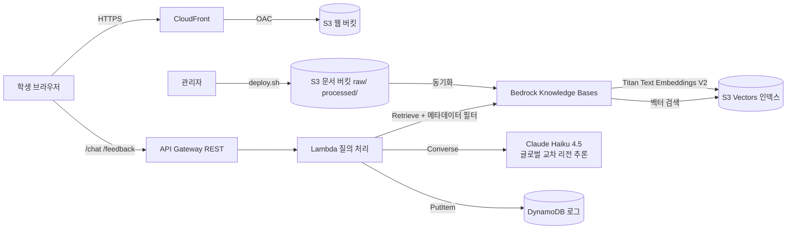

# CNU 학사도우미

충남대학교 학사 공지, 학칙·학사 규정, 장학금 안내, 졸업요건 문서를 근거로 학생의 질문에 답하고, 답변마다 근거 문서와 원문 링크를 보여 주는 RAG 챗봇입니다.

현재 단계는 **MVP**입니다. 문서 검색(Bedrock Knowledge Bases + S3 Vectors) → 근거 판단 → Claude 답변 생성 → 출처 표시까지 동작합니다.
등록된 문서(`data/docs/`)는 개발·시연용으로 직접 작성한 **가상 예시 자료**입니다.

## 구성 (서울 리전 ap-northeast-2)



| 구성 요소 | AWS 서비스 | 역할 |
|---|---|---|
| 웹 프론트엔드 | S3 + CloudFront (OAC) | 질문 입력, 답변·출처 카드, 근거 부족 안내, 피드백 |
| 백엔드 API | API Gateway (REST) + Lambda (Python 3.12) | 입력 검증·마스킹 → 검색 → 근거 판단 → 답변 생성 → 기록 |
| 문서 저장소 | S3 (raw/ 원본, processed/ 검색용 + `.metadata.json`) | Knowledge Base 데이터 소스 |
| 검색 | Bedrock Knowledge Bases + S3 Vectors | 300토큰·20% 겹침 분할, Titan V2(1024차원) 임베딩, 학번·학과·만료일 필터 |
| 생성 모델 | Claude Haiku 4.5 (`global.anthropic.claude-haiku-4-5-20251001-v1:0`) | 제공된 근거만 사용, 문장마다 근거 번호 표기. 템플릿 파라미터 `GenerationModelName`으로 교체 가능 |
| 로그 | DynamoDB (TTL 90일), CloudWatch Logs (90일) | 질문·출처·점수·근거 부족 여부·피드백 |

## 질문 처리 흐름 (`backend/app.py`)

1. 질문 길이 검증, 학번(9~10자리)·전화번호를 `[학번]`·`[전화번호]`로 가림
2. Knowledge Base `Retrieve` 상위 5개 — 필터: 만료일 ≥ 오늘, (선택 시) 학번 범위, (선택 시) 학과 또는 전체 공통
3. 기준 점수(`MinScore`, 기본 0.35) 이상인 청크가 없으면 **모델을 호출하지 않고** 근거 부족 + 담당 부서 안내
4. 같은 문서의 청크를 하나의 출처로 묶어 번호를 붙이고, Claude에 "근거만 사용·근거 번호 표기·근거 없으면 NO_ANSWER" 지시
5. 답변에서 인용된 번호의 출처만 카드로 반환, DynamoDB에 기록

## 배포 (AWS CloudShell)

처음 한 번은 Bedrock 콘솔에서 Claude Haiku 4.5를 플레이그라운드로 호출해 Anthropic 모델 사용 신청을 마쳐야 합니다.

```bash
git clone https://github.com/hyunjun629/cnu-haksa-chatbot.git   # 이미 있으면: cd cnu-haksa-chatbot && git pull
cd cnu-haksa-chatbot
bash scripts/deploy.sh
```

스크립트가 템플릿 검사 → 스택 배포 → 웹 업로드 → 문서 업로드 → Knowledge Base 동기화 → `/health`·`/chat` 확인까지 진행합니다.

## 로컬 테스트

```bash
pip install -r requirements-dev.txt
python -m pytest -q
```

## 삭제

```bash
bash scripts/cleanup.sh
```

## 개발 기록

오류와 해결 과정은 [docs/debug-log.md](docs/debug-log.md)에 정리합니다.
