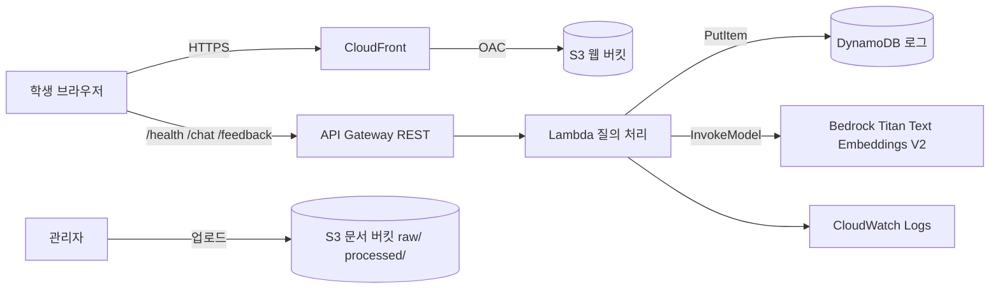

# CNU 학사도우미

충남대학교 학사 공지, 학칙·학사 규정, 장학금 안내, 졸업요건 문서를 근거로 학생의 질문에 답하고, 답변마다 근거 문서와 원문 링크를 보여 주는 RAG 챗봇입니다.

이 저장소는 **AWS 기본 실행 환경과 테스트 API** 단계입니다. 문서 검색(Bedrock Knowledge Bases + OpenSearch Serverless)과 답변 생성(Claude)은 다음 단계에서 연결합니다.

## 현재 구성 (서울 리전 ap-northeast-2)



| 구성 요소 | AWS 서비스 | 이번 단계에서 하는 일 |
|---|---|---|
| 웹 프론트엔드 | S3 + CloudFront (OAC) | 테스트 채팅 화면 호스팅, 버킷은 비공개 |
| 백엔드 API | API Gateway (REST) + Lambda (Python 3.12) | `/health`, `/chat`, `/feedback` 응답, 요청 제한 |
| 문서 저장소 | S3 (버전 관리, 암호화, raw/·processed/) | 샘플 문서와 메타데이터 업로드 |
| 대화·피드백 저장 | DynamoDB (온디맨드, TTL 90일) | 질문·피드백 기록 |
| 임베딩 모델 | Bedrock Titan Text Embeddings V2 | 호출 권한·연결 확인 (1024차원) |
| 로그 | CloudWatch Logs (보존 90일) | Lambda 실행 로그 |
| 접근 권한 | IAM (CloudFormation이 역할 생성) | Lambda에 `dynamodb:PutItem`, 지정 모델 `bedrock:InvokeModel`만 허용 |

## 폴더 구조

```
template.yaml          AWS 리소스 전체 정의 (AWS SAM / CloudFormation)
backend/app.py         Lambda 함수 (질의 검증, 학번·전화번호 마스킹, Bedrock 연결 확인, 로그 기록)
frontend/              테스트 화면 (index.html, app.js) — config.js는 배포 때 자동 생성
data/sample/           샘플 문서와 Knowledge Bases 메타데이터 형식 예시
scripts/deploy.sh      배포 + 웹 업로드 + 동작 확인
scripts/cleanup.sh     만든 리소스 전체 삭제
tests/test_app.py      Lambda 단위 테스트 (AWS 호출은 가짜 객체)
```

## 배포 (AWS CloudShell)

1. AWS 콘솔 오른쪽 위 리전을 **아시아 태평양(서울)** 으로 바꾸고 CloudShell을 엽니다.
2. 아래 명령을 실행합니다.

```bash
git clone https://github.com/<GitHub 아이디>/cnu-haksa-chatbot.git
cd cnu-haksa-chatbot
bash scripts/deploy.sh
```

마지막에 웹 화면 주소와 API 주소가 출력됩니다. CloudFront는 처음 만들 때 몇 분 정도 걸릴 수 있습니다.

## 동작 확인

```bash
API=<출력된 API 주소>
curl -s $API/health
curl -s -X POST $API/chat -H "Content-Type: application/json" -d '{"question":"휴학은 최대 몇 학기까지 할 수 있어?"}'
```

`/chat` 응답의 `checks.bedrockEmbedding.ok`가 `true`이고 `dimension`이 `1024`이면 Bedrock 연결과 IAM 권한이 정상입니다.

## 로컬 테스트

```bash
pip install -r requirements-dev.txt
python -m pytest -q
```

## 삭제

과제 확인이 끝나면 비용이 계속 나가지 않도록 삭제합니다.

```bash
bash scripts/cleanup.sh
```

## 비용 메모

- 사용한 서비스는 모두 사용량 기반 요금이며, 테스트 수준 호출은 거의 비용이 나지 않습니다.
- API Gateway 요청 제한을 초당 5건(버스트 10건)으로 낮게 잡아 비용 폭증을 막았습니다.
- OpenSearch Serverless와 AWS WAF는 켜 두는 동안 고정 비용이 있어 이 단계에서는 만들지 않았습니다.
